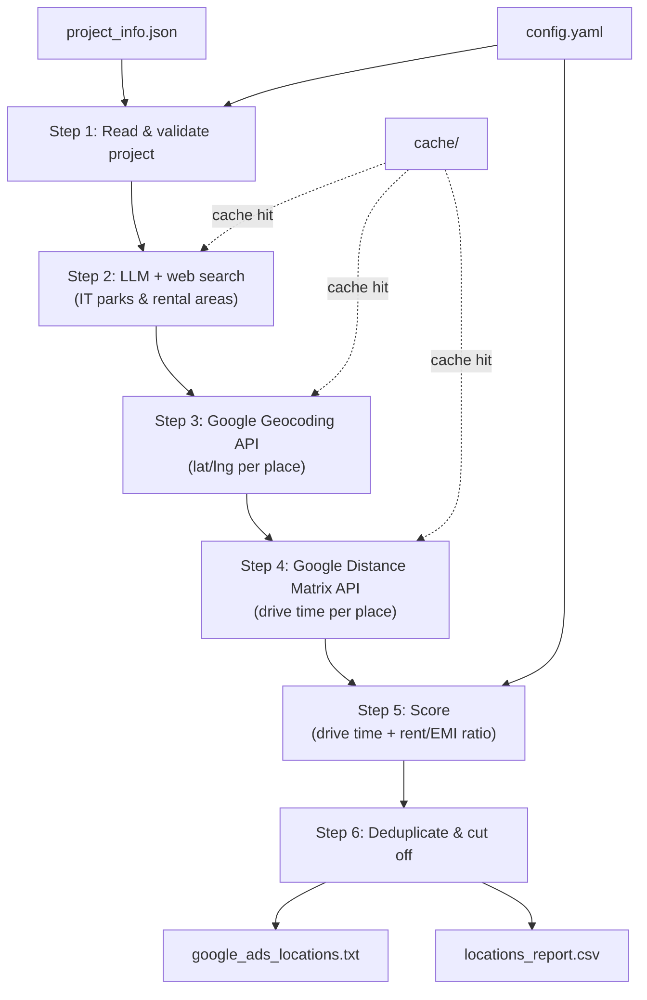

# Architecture: Location List Builder

**Roadmap tasks:** 1.2–1.4 | **Entry point:** `build_locations.py`

---

## System Overview

The Location List Builder is a single-command Python tool that turns a **project info JSON** into a ranked list of Google Ads radius targets. It orchestrates four external APIs sequentially, caches every remote call, and writes two output files that require no post-processing before use.

```
project_info.json + config.yaml
         │
         ▼
  build_locations.py
         │
   ┌─────┴──────┐
   │  6-step    │
   │  pipeline  │
   └─────┬──────┘
         │
   ┌─────┴─────────────────────┐
   │                           │
output/google_ads_locations.txt  output/locations_report.csv
```

---

## High-Level Data Flow



---

## Module Breakdown

### `build_locations.py` — Orchestrator

- Parses CLI args (`--project <path>`)
- Loads `config.yaml` and the project JSON
- Calls each step in order and passes results forward
- Writes both output files

### `steps/read_project.py` — Step 1

**Responsibilities:**
- Parse and validate the project info JSON
- Extract `location.lat`, `location.lng`, `location.address`, `location.city`
- If lat/lng are absent, call the Geocoding API to resolve the address
- Abort with a clear error if the address resolves only to a city or pincode
- Extract `units[]` where `status = available` → compute EMI per unit type

**Key output:** `ProjectData` dataclass (coords, name, unit EMIs)

### `steps/list_places.py` — Step 2

**Responsibilities:**
- Build a structured prompt for the LLM including project address and `search_radius_km`
- Call LLM with web-search enabled
- Parse response into two lists: IT parks and rental localities (each with rent + source URL)
- **Never** accept coordinates or drive times from LLM output — strip or reject them

**Key output:** `List[Place]` (name, type, rent_2bhk, rent_3bhk, source_url)

### `steps/geocode.py` — Step 3

**Responsibilities:**
- For each place, call Google Geocoding API with `"<name>, <city>"`
- Validate that the resolved point lies within `search_radius_km` of the project
- Drop places that resolve to a bounding box larger than a neighbourhood (whole-city results)
- Record dropped places in the report with reason

**Key output:** `List[Place]` with `.lat`, `.lng` populated (4 decimal places)

### `steps/drive_times.py` — Step 4

**Responsibilities:**
- Batch-call Google Distance Matrix API (origin = project, destinations = all places)
- Use weekday peak-hour departure time
- Attach `drive_minutes` to each place
- Drop places over `max_drive_minutes`

**Key output:** `List[Place]` with `.drive_minutes` populated

### `steps/score.py` — Step 5

**Responsibilities:**
- IT parks: `score = f(drive_minutes)` — linear decay
- Rental areas:
  - For each available unit type, compute `ratio = area_rent / unit_emi`
  - Take best ratio across unit types
  - Map ratio to score band (from `config.yaml`)
  - Apply drive-time adjustment
- Attach `.score` and `.score_reason` to each place

**Key output:** `List[Place]` sorted by score descending

### `steps/write_output.py` — Step 6

**Responsibilities:**
- Remove overlapping circles (same-type circles within `overlap_threshold_km`), keep higher score
- Apply `max_targets` cap
- Write `output/google_ads_locations.txt` — one `(Nkm:lat:lng)` per line
- Write `output/locations_report.csv` — one row per place (kept and dropped)

---

## External Dependencies

| Dependency | Purpose | Auth |
|---|---|---|
| Google Geocoding API | lat/lng from place name | `GOOGLE_MAPS_API_KEY` env var |
| Google Distance Matrix API | Drive times at peak hour | `GOOGLE_MAPS_API_KEY` env var |
| LLM (Groq: llama-3.3-70b-versatile) | IT park & rental area discovery, rents + sources | `GROQ_API_KEY` env var |

> [!IMPORTANT]
> API keys must **never** appear in code or the repo. Load from environment variables only.

---

## Caching Layer

All remote calls are wrapped in a file-based cache under `cache/`.

```
cache/
├── geocode/
│   └── <sha256(query)>.json
├── distance/
│   └── <sha256(origin+destinations)>.json
└── llm/
    └── <sha256(prompt)>.json
```

- Cache key = SHA-256 of the full request payload
- Cache is read before every API call; written after every successful response
- Guarantees **deterministic reruns** on the same project JSON

---

## File Layout

```
build_locations.py          # Entry point / orchestrator
config.yaml                 # Tunable defaults (all overridable per project)
steps/
├── read_project.py         # Step 1
├── list_places.py          # Step 2
├── geocode.py              # Step 3
├── drive_times.py          # Step 4
├── score.py                # Step 5
└── write_output.py         # Step 6
models.py                   # Place, ProjectData dataclasses
cache/                      # Auto-created; gitignored
output/                     # Auto-created
├── google_ads_locations.txt
└── locations_report.csv
tests/
├── test_score.py
├── test_geocode.py
└── fixtures/               # Sample inputs with known expected outputs
```

---

## Output Formats

### `output/google_ads_locations.txt`

```
(3km:12.9800:77.7200)
(2km:12.9900:77.7100)
```

- Format: `(<radius_km>km:<lat>:<lng>)` — no spaces, exactly 4 decimal places
- IT parks use `radius_km_it_park`; rental areas use `radius_km_rental`
- Max 500 lines (hard cap from Google Ads)

### `output/locations_report.csv`

| Column | Description |
|---|---|
| `name` | Place name |
| `type` | `it_park` or `rental_area` |
| `lat`, `lng` | Geocoded coordinates |
| `drive_minutes` | Peak-hour drive time |
| `rent_2bhk`, `rent_3bhk` | Monthly rent (₹) |
| `rent_source` | Source URL |
| `rent_date` | Date rent was fetched |
| `emi` | Matched unit type EMI (₹) |
| `ratio` | `rent / emi` |
| `score` | Final score |
| `kept` | `yes` / `no` |
| `reason` | Why kept or dropped |

---

## Key Design Decisions

| Decision | Rationale |
|---|---|
| LLM provides names only — no coordinates | Prevents hallucinated locations; all spatial data comes from authoritative APIs |
| File-based cache keyed by request hash | Reruns are free and deterministic; safe to share `cache/` across team members |
| Config-driven scoring bands | Thresholds tune to market conditions without touching code |
| Overlap deduplication before cap | Avoids wasting targets on the same physical area |
| Abort on ambiguous address | Every downstream step depends on a precise project point; a city-level point would produce meaningless radii |
| Rent sources required | Ensures every targeting decision is auditable; prevents stale or fabricated rent data |

---

## Constraints & Rules

- Nothing in the code is specific to one city or project — all parameters come from the JSON or `config.yaml`
- Coordinates must have exactly 4 decimal places and lie within `search_radius_km` of the project point
- Output lines must match `(<number>km:<lat>:<lng>)` exactly — any deviation breaks Google Ads bulk import
- At most 500 output lines (Google Ads hard limit); `max_targets` default is 50

---

## Downstream Consumers

| Consumer | How they use this tool's output |
|---|---|
| **Task 1.7** — Targeting pack | Merges location targets with keyword list |
| **Tasks 3.2a / 3.2b** — Search & Demand Gen campaigns | Paste `google_ads_locations.txt` into Google Ads Editor |
| **Tasks 3.3a / 3.3b** — API campaign creation | Read `google_ads_locations.txt` and convert each line to a proximity target via the Google Ads API |

---

## Out of Scope

- Scraping rental listing sites directly
- Rental listing counts / demand sizing
- Location bid adjustments by score
- Projects outside India
- Creating the campaigns (handled in tasks 3.3a / 3.3b)
