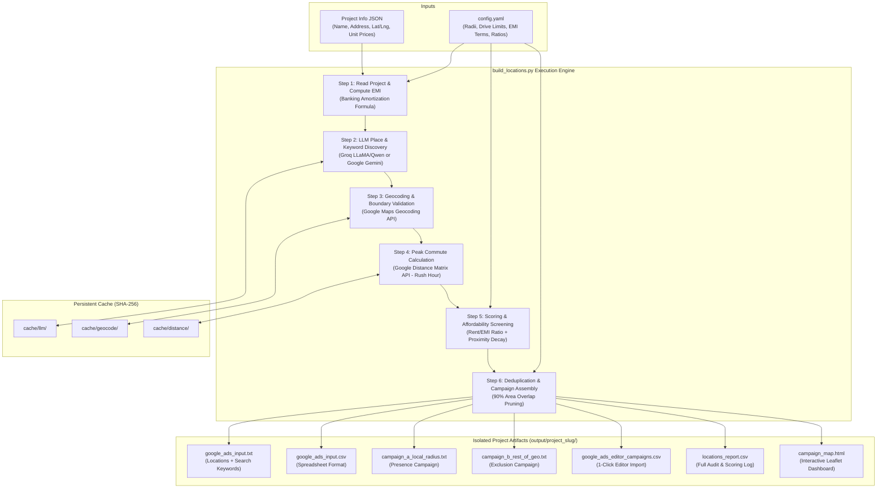

# System Specification: Real Estate Location List Builder & Google Ads Campaign Engine

**Document Version:** 1.0.0  
**Status:** Approved / Production  
**Author:** DeepMind Agentic Engineering  
**Target Audience:** Engineering, Product, Performance Marketing, and Data Science Teams  
**Repository:** [https://github.com/Daminigit/No_historical_data](https://github.com/Daminigit/No_historical_data)  

---

## 1. Executive Summary & Purpose

The **Real Estate Location List Builder** is an automated geo-intelligence and performance marketing system designed for residential property developers. It transforms raw project details (property coordinates, addresses, and apartment unit prices) into **hyper-targeted, mathematically optimized Google Ads Search & Radius campaigns**.

### 1.1 The Business Problem
In digital real estate advertising, developers and marketing agencies frequently waste **35% to 50% of ad spend** due to:
1. **Broad Geo-Targeting:** Bidding on entire metropolitan regions (e.g., "All of Pune" or "All of Bengaluru"), paying ₹150–₹350 per click for users living 30+ km away who will never commute to the project.
2. **Campaign Self-Competition (Cannibalization):** Running local and regional campaigns that bid against one another for the exact same impressions, driving up Cost-Per-Click (CPC).
3. **Unaffordable Lead Inundation:** Showing ads to renters in low-income clusters who cannot qualify for a home loan for the project's price point.
4. **Wasted Negative Search Volume:** Paying for commercial real estate, rental inquiries (`flat for rent`, `PG in Whitefield`), and employment queries (`jobs in Hinjewadi`).

### 1.2 The System Solution
This system deterministically executes an automated 6-step pipeline that:
- **Discovers** prominent corporate employment parks (IT hubs, SEZs, industrial belts) and residential rental corridors along real commuter routes.
- **Validates** all coordinates against Google Maps Ground Truth, filtering out ambiguous or distant locations.
- **Calculates peak-traffic drive times** via Google Distance Matrix (Monday 8:30 AM peak rush hour).
- **Assesses financial affordability** using actual loan amortization EMIs against local rental yields.
- **Prunes spatial redundancy** using a 90% geometric circle overlap deduplication algorithm.
- **Generates a two-tier campaign structure** (Campaign A Local Presence vs. Campaign B Regional Exclusions), complete with 1-click Google Ads Editor CSVs, negative keywords, and an interactive GIS visual dashboard.

---

## 2. High-Level System Architecture

The pipeline follows a deterministic pipeline pattern with cached remote API integrations:



---

## 3. Mathematical & Algorithmic Formulations

### 3.1 Monthly Home Loan EMI Calculation
For each configured apartment configuration (e.g., 2BHK, 3BHK), the monthly repayment burden is calculated using standard banking amortization:

$$P = \text{Price}_{\text{min}} \times \left(1 - \frac{\text{DownPaymentPct}}{100}\right)$$

$$r = \frac{\text{InterestRatePct}}{100 \times 12}, \quad n = \text{TenureYears} \times 12$$

$$\text{EMI} = P \times \frac{r(1+r)^n}{(1+r)^n - 1}$$

*Default Configuration:* Down payment = 20%, Interest rate = 8.5% p.a., Tenure = 20 years ($n = 240$ months).

---

### 3.2 Affordability Assessment (Rent-to-EMI Ratio)
For any candidate residential rental locality $L$, the maximum ratio across all available unit configurations is determined:

$$\text{Ratio}(L) = \max_{u \in \text{Units}} \left( \frac{\text{Rent}_u(L)}{\text{EMI}_u} \right)$$

The candidate locality is classified according to configurable ratio bands:

| Ratio Range | Affordability Tier | Score | Action | Rationale |
| :--- | :---: | :---: | :---: | :--- |
| $\text{Ratio} < 0.30$ | Low | 1.0 | **DROP** | Renters cannot afford the project EMI; high default risk. |
| $0.30 \le \text{Ratio} < 0.45$ | Medium | 5.0 | **KEEP** | Stretch buyers; viable loan transition candidates. |
| $0.45 \le \text{Ratio} < 0.90$ | High | 10.0 | **KEEP** | Prime buyers; current rent is comparable to project EMI. |
| $\text{Ratio} \ge 0.90$ | Medium | 5.0 | **KEEP** | Ultra-affluent or high-luxury micro-market. |

*Immediate Locality Safeguard:* If the drive time from the candidate to the project is $\le 3.0$ minutes, the locality is **retained as a core catchment regardless of ratio tier**, ensuring the project's own immediate neighborhood is never dropped.

---

### 3.3 Employment Hub (IT Park) Proximity Decay Scoring
For corporate employment hubs, buyer demand is an inverse function of commute friction:

$$\text{Score}_{\text{IT}} = \max\left(1.0, \, 10.0 - \left( \frac{\text{DriveMinutes}}{\text{MaxDriveMinutes}} \right) \times 9.0 \right)$$

* A 0-minute commute scores **10.0** (maximum priority).
* A commute equal to $\text{MaxDriveMinutes}$ (default 60 min) scores **1.0**.
* Locations exceeding $\text{MaxDriveMinutes}$ are dropped in Step 4.

---

### 3.4 Spatial Deduplication & 90% Area Overlap Pruning
When two targeting circles overlap excessively, bidding on both wastes budget.

1. **Center Distance Check:**
   $$\text{Dist}(c_1, c_2) = 2R \arcsin \sqrt{\sin^2\left(\frac{\Delta \phi}{2}\right) + \cos \phi_1 \cos \phi_2 \sin^2\left(\frac{\Delta \lambda}{2}\right)}$$
   If $\text{Dist}(c_1, c_2) < \text{overlap\_threshold\_km}$ (default 1.0 km), the lower-scoring target is dropped immediately.

2. **Geometric Area Overlap Check:**
   For circles with radii $r_1, r_2$ and center separation $d$:
   $$A_{\text{overlap}} = r_1^2 \arccos\left(\frac{d^2 + r_1^2 - r_2^2}{2dr_1}\right) + r_2^2 \arccos\left(\frac{d^2 + r_2^2 - r_1^2}{2dr_2}\right) - \frac{1}{2}\sqrt{(-d+r_1+r_2)(d+r_1-r_2)(d-r_1+r_2)(d+r_1+r_2)}$$
   $$\text{OverlapRatio} = \frac{A_{\text{overlap}}}{\pi \cdot \min(r_1, r_2)^2}$$
   If $\text{OverlapRatio} \ge 0.90$ (90% area overlap), the circle with the lower composite score is pruned.

---

## 4. Pipeline Step Specifications

### Step 1: Read Project (`steps/read_project.py`)
* **Input:** File path to project info JSON.
* **Validation:** Validates project name and resolves coordinates. If `lat` and `lng` are missing, automatically triggers Google Geocoding on `address + city`.
* **Output:** Strongly-typed `ProjectData` object populated with `UnitEMI` calculations.

### Step 2: Place & Keyword Discovery (`steps/list_places.py`)
* **Backend:** Groq API (`qwen/qwen3.8-27b`) or Google Gemini API (`gemini-1.5-flash`).
* **Prompt Engineering:** Enforces discovery strictly within the project's actual commuter sector and adjacent feeder neighborhoods.
* **Safety Filter:** Strips any LLM-hallucinated coordinates or distances before passing to geocoding.

### Step 3: Geocoding Validation (`steps/geocode.py`)
* **Service:** Google Geocoding API (`maps.googleapis.com/maps/api/geocode/json`).
* **Filtering Rules:**
  - Rejects bounding boxes with diagonals $> 12.0\text{ km}$ (eliminating broad whole-city or district matches).
  - Permits `APPROXIMATE` location types specifically for large business districts and multi-square-kilometer tech campuses (e.g. Rajiv Gandhi Infotech Park Hinjewadi).
  - Enforces hard search radius boundary: $\text{Dist}(\text{Project}, \text{Place}) \le \text{search\_radius\_km}$.

### Step 4: Commute Time Analysis (`steps/drive_times.py`)
* **Service:** Google Distance Matrix API (`maps.googleapis.com/maps/api/distancematrix/json`).
* **Traffic Model:** Modeled on the next upcoming **Monday at 8:30 AM IST** using `traffic_model="pessimistic"`.
* **Cutoff:** Discards locations with drive time $> \text{max\_drive\_minutes}$ (default 60 mins).

### Step 5: Scoring (`steps/score.py`)
* Calculates proximity scores for IT parks and Rent/EMI ratios for residential rental areas.
* Drops low-income tenant areas ($\text{Ratio} < 0.30$) while preserving immediate project catchment ($\le 3$ min drive).

### Step 6: Output Generation (`steps/write_output.py`)
* Applies deduplication and targets cap.
* Writes isolated outputs into `output/<project_slug>/`.
* Produces Google Ads Editor bulk CSVs, single input files, audit logs, and synchronized HTML maps.

---

## 5. Campaign Architecture & Google Ads Strategy

```
┌────────────────────────────────────────────────────────────────────────┐
│                        GOOGLE ADS ACCOUNT                              │
├───────────────────────────────────┬────────────────────────────────────┤
│   CAMPAIGN A: LOCAL RADIUS        │   CAMPAIGN B: REST OF GEO          │
├───────────────────────────────────┼────────────────────────────────────┤
│ • Setting: Presence Only          │ • Setting: Presence or Interest    │
│ • Targets: Non-overlapping circles│ • Target: City or Country wide     │
│   (2km rental, 3km IT park)       │ • Exclusions: Campaign A circles   │
│ • Keywords: High-intent generic   │ • Keywords: Place-specific terms   │
│   ("2 BHK flats", "new apartments")│   ("flats in Whitefield", etc.)    │
│ • Audience: Local techies/renters │ • Audience: Relocators & investors │
│ • Budget Split: 65% - 70%         │ • Budget Split: 30% - 35%          │
├───────────────────────────────────┴────────────────────────────────────┤
│   SHARED NEGATIVE KEYWORDS: rent, PG, hostel, resale, jobs, salary, etc│
└────────────────────────────────────────────────────────────────────────┘
```

---

## 6. Project Schema Specification

Project definitions accept standard or flat JSON:

```json
{
  "status": "active",
  "project": {
    "name": "Vision Flora"
  },
  "location": {
    "lat": 18.5990,
    "lng": 73.7980,
    "address": "Vision Flora, Pimple Saudagar, Pimpri-Chinchwad, Pune, Maharashtra 411027",
    "city": "Pune"
  },
  "units": [
    {
      "type": "2BHK",
      "status": "available",
      "price_min_inr": 8500000
    },
    {
      "type": "3BHK",
      "status": "available",
      "price_min_inr": 12000000
    }
  ]
}
```

---

## 7. Configuration Schema (`config.yaml`)

```yaml
# Discovery boundary around project (km)
search_radius_km: 25

# Peak-hour commute cutoff (minutes)
max_drive_minutes: 60

# Radius circle dimensions
radius_km_it_park: 3
radius_km_rental: 2

# Maximum exported targets
max_targets: 50

# Spatial deduplication controls
overlap_threshold_km: 1.0
overlap_threshold_ratio: 0.90

# Loan amortization parameters
down_payment_pct: 20
interest_rate_pct: 8.5
tenure_years: 20

# Rent / EMI Affordability evaluation bands
ratio_bands:
  - ratio_max: 0.30
    score: 1
    label: "low"
  - ratio_max: 0.45
    score: 5
    label: "medium"
  - ratio_max: 0.90
    score: 10
    label: "high"
  - ratio_max: 9999
    score: 5
    label: "medium"
```

---

## 8. Test Suite & Verification Matrix

The test suite contains **43 automated unit tests** across 7 modules:

| Test Module | Coverage Scope | Verified Behaviors |
| :--- | :--- | :--- |
| `test_emi.py` | Step 1 Loan Mathematics | • Exact EMI calculation matching financial amortization tables.<br>• Edge cases: 0% down payment, custom tenures. |
| `test_geocode.py` | Step 3 Boundary Validation | • Precision acceptance of valid rooftop & locality coordinates.<br>• Rejection of whole-city bounding boxes ($> 12\text{ km}$).<br>• Distance threshold enforcement. |
| `test_list_places.py` | Step 2 Discovery & Guardrails | • Parsing of LLM JSON responses.<br>• Coordinate stripping to prevent LLM hallucinations.<br>• Keyword extraction. |
| `test_score.py` | Step 5 Scoring Algorithms | • Proximity decay for IT parks.<br>• Ratio band lookups and drop triggers for low-rent zones.<br>• Retention of immediate project neighborhood. |
| `test_campaigns.py` | Step 6 Campaign Assembly | • Campaign A presence setting enforcement.<br>• Campaign B exclusion generation matching Campaign A targets.<br>• Negative keyword inclusion. |
| `test_output_format.py` | Output Formatting & Isolation | • Format compliance: `(radius km:lat:lng)`.<br>• Project directory isolation in `output/<slug>/`.<br>• Single result file format validation. |
| `test_no_latlng.py` | Geocoding Fallback | • Automatic address-based geocoding when coordinates are absent in JSON. |

---

## 9. Performance & System Limits

* **Execution Time:** ~4–7 seconds on cold run; < 0.25 seconds on cached run.
* **API Call Footprint:** 1 LLM call, $N$ Geocoding calls, $M$ Distance Matrix calls per new project. All results are cached locally via SHA-256 in `cache/` indefinitely.
* **Google Ads Limits:** Strictly respects the Google Ads API hard ceiling of **500 radius targets per campaign** (`max_targets: 50` default).
